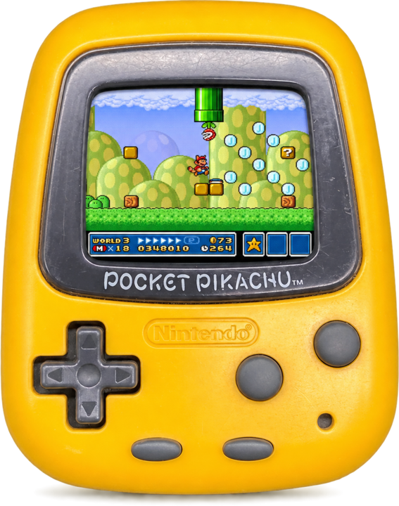
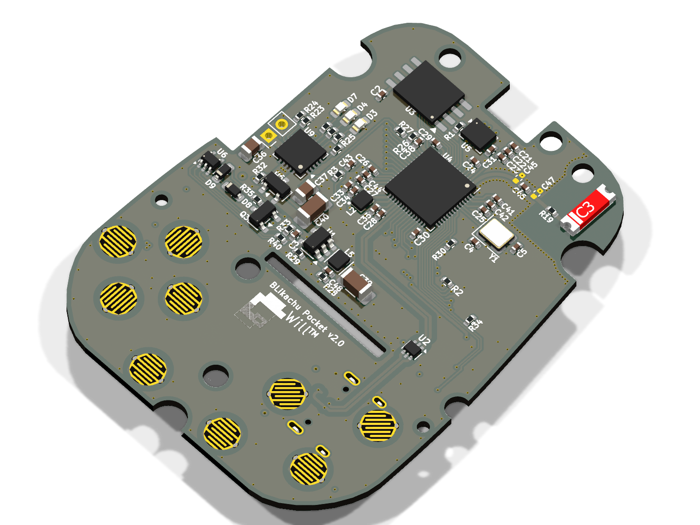

<div align="center">



# BLikachu Pocket

**A Game Boy, NES and SNES handheld inside a Pocket Pikachu: a replacement BL618 board and Zephyr firmware for the
Nintendo MPG-001 shell.**

[](https://github.com/will-tm/blikachu-pocket/actions/workflows/build.yml)
[](https://github.com/will-tm/blikachu-pocket/actions/workflows/pcb-render.yml)
[](firmware/west.yml)
[](hardware/blikachu-pocket.kicad_pro)

**[Hardware](#hardware) · [Build and flash](#build-and-flash) · [Add games](#add-games) · [Controls](#controls) · [Firmware docs](firmware/README.md)**

</div>

## New insides, same shell

- **Three systems:** GB and GBC (Gambatte), NES (FCEUmm) and SNES (Snes9x2005), picked from the ROM's header and
  extension.
- **Saves:** save states, cartridge battery RAM and RTC data, kept across firmware updates.
- **Wi-Fi:** a web UI to upload and delete ROMs, play remotely and update the firmware over the air.
- **USB:** DFU firmware updates, a shell, and ROM and save uploads without Wi-Fi.

## How it works

<p align="center">
  <picture>
    <source media="(prefers-color-scheme: dark)" srcset="assets/overview-dark.svg">
    
  </picture>
</p>

## Hardware

<p align="center"></p>

| Part    | Detail                                                             |
| ------- | ------------------------------------------------------------------ |
| SoC     | Bouffalo Lab BL618 RISC-V, 4 MiB PSRAM, CPU overclocked to 480 MHz |
| Flash   | W25Q512JV, 64 MiB QSPI                                             |
| Display | ST7789V SPI colour LCD, 240×216 visible                            |
| Input   | D-pad and four buttons                                             |
| Sound   | PWM buzzer                                                         |
| Motion  | LSM6DSV16X IMU                                                     |
| Power   | MCP73871 Li-ion charger, battery measurement, GPIO power latch     |
| Radio   | Wi-Fi                                                              |
| USB     | High speed: CDC shell and DFU                                      |

Open [the KiCad project](hardware/blikachu-pocket.kicad_pro) in KiCad 10.

## Build and flash

You need Python 3, CMake, Ninja, [Zephyr SDK](https://github.com/zephyrproject-rtos/sdk-ng/releases) 1.0.1 with the
RISC-V toolchain, and `dfu-util`. On macOS:

```sh
brew install cmake ninja dtc dfu-util
cd firmware
./build.sh
```

**First flash:** hold BOOT while resetting, release it, then pass the serial port that appears:

```sh
FLASH_PORT=/dev/cu.usbmodemXXXXX ./build.sh flash
```

**Updates:** with the firmware running, no buttons needed:

```sh
./build.sh flash
```

Keep power connected until the board reboots: `Download done` means the transfer has finished, not the installation.

### Recovery

An interrupted or broken install is recovered the same way as the first flash: BOOT, reset, then `./build.sh flash`
with `FLASH_PORT`. Details: [firmware documentation](firmware/README.md#firmware-updates).

## Add games

Upload your own `.gb`, `.gbc`, `.nes`, `.sfc` or `.smc` files.

**Over Wi-Fi:** add a network from the USB shell, then open the board's IP address in a browser:

```text
wifi_cred add <ssid> <passphrase>
wifi_cred connect
```

**Over USB:** from the `firmware` directory. This also sends libretro save files.

```sh
source .venv/bin/activate
python tools/usb_upload.py --port /dev/cu.usbmodemXXXXX game.gbc
```

SNES support covers ordinary LoROM and HiROM cartridges; enhancement-chip games are rejected.

## Controls

| Buttons               | Action            |
| --------------------- | ----------------- |
| SELECT + START        | Quit to the menu  |
| SELECT + B            | Save state        |
| SELECT + A            | Restore state     |
| SELECT + UP / DOWN    | Volume            |
| SELECT + LEFT / RIGHT | Brightness        |
| Hold START            | Request power-off |

On SNES, A and B act as B and Y, SELECT + A / B as A and X, and SELECT + LEFT / RIGHT as L and R. Save states and
brightness move to the shell. Remote play exposes all twelve SNES buttons.

## Development

- [Firmware documentation](firmware/README.md): cores, storage, updates and the shell.
- [Firmware development notes](firmware/CLAUDE.md): pin assignments, scheduling and memory constraints, Zephyr
  patches.

GitHub Actions builds the firmware and renders the PCB in 3D on hardware changes. The render above is refreshed on
pushes to `main`; pull requests get a preview artifact.

## Disclaimers

BLikachu Pocket is provided **as is, without any warranty**: you modify your device at your own risk.

- It is an independent hardware and firmware project, not affiliated with or endorsed by Nintendo. Nintendo, Game Boy,
  Pokémon and Pikachu are trademarks of their respective owners.
- No games are included.
- The emulator cores keep their own licenses, in their dependency repositories. Snes9x's license includes
  non-commercial distribution restrictions.
